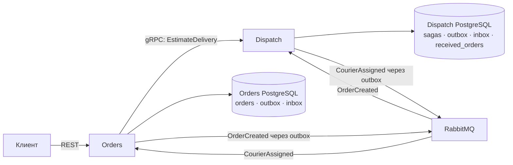

# Courier Dispatch

[](https://github.com/LegionAlpha/CourierDispatch/actions/workflows/ci.yml)
[](https://dotnet.microsoft.com/)
[](LICENSE)

Учебный backend для доставки: принимает заказ, рассчитывает цену и время, назначает курьера и возвращает результат в сервис заказов.

Проект помогает разобраться, как работают независимые сервисы: синхронные вызовы по gRPC, события через RabbitMQ, транзакции PostgreSQL и обработка повторной доставки сообщений.

> **Текущий этап: 2e.** Полный цикл `Created → Assigned` работает. Назначение пока выполняет заглушка с фиксированным курьером. Kafka и Redis запускаются в Compose; обработка геопозиций и поиск ближайшего курьера — следующие этапы.

**Навигация:** [Быстрый старт](#быстрый-старт) · [Проверка API](#проверка-api) · [Архитектура](#архитектура) · [Надёжность](#надёжность) · [Разработка](#локальная-разработка) · [Тесты](#тесты) · [Планы](#roadmap)

## Быстрый старт

Нужны Git и Docker с Compose v2; на Windows — запущенный Docker Desktop в режиме Linux containers. Для запуска целиком в контейнерах .NET SDK на компьютере не требуется.

```bash
git clone https://github.com/LegionAlpha/CourierDispatch.git
cd CourierDispatch
docker compose up -d --build --wait
```

Compose соберёт Orders и Dispatch, запустит инфраструктуру, применит миграции обеих БД и дождётся готовности сервисов. Контейнеры `orders-migrate` и `dispatch-migrate` завершаются с кодом `0`: это штатный результат.

```bash
docker compose ps -a
docker compose logs --tail 100 orders dispatch
```

| Компонент | Адрес с компьютера | Назначение |
| --- | --- | --- |
| Orders | `http://127.0.0.1:5100` | REST API заказов |
| Dispatch | `http://127.0.0.1:5200` | gRPC по HTTP/2 без TLS в локальной среде |
| PostgreSQL Orders | `127.0.0.1:5433` | БД, пользователь и пароль: `orders` |
| PostgreSQL Dispatch | `127.0.0.1:5434` | БД, пользователь и пароль: `dispatch` |
| RabbitMQ | `127.0.0.1:5672` | Доставка событий |
| RabbitMQ Management | [localhost:15672](http://localhost:15672) | Пользователь и пароль: `courier` |
| Kafka | `localhost:9092` | Инфраструктура для будущего потока геопозиций |
| Redis | `127.0.0.1:6379` | Инфраструктура для будущего GEO-индекса |

Порты опубликованы только на loopback-интерфейсе. Учётные данные в Compose предназначены для локальной разработки.

```bash
# Остановить контейнеры, сохранив их и данные
docker compose stop

# Удалить контейнеры и сеть; данные останутся в именованных volumes
docker compose down
```

## Проверка API

### Создать заказ и дождаться назначения

Пример для PowerShell:

```powershell
$body = @{
    fromLatitude = 25.2048
    fromLongitude = 55.2708
    toLatitude = 25.1972
    toLongitude = 55.2744
} | ConvertTo-Json

$order = Invoke-RestMethod -Method Post -Uri 'http://127.0.0.1:5100/orders' -ContentType 'application/json' -Body $body
$order

# Назначение асинхронное: опрашиваем заказ до 30 секунд
for ($attempt = 0; $attempt -lt 30; $attempt++) {
    $current = Invoke-RestMethod "http://127.0.0.1:5100/orders/$($order.id)"
    if ($current.status -eq 'Assigned') { break }
    Start-Sleep -Seconds 1
}
$current
```

Для Bash:

```bash
curl -i -X POST http://127.0.0.1:5100/orders \
  -H 'Content-Type: application/json' \
  -d '{"fromLatitude":25.2048,"fromLongitude":55.2708,"toLatitude":25.1972,"toLongitude":55.2744}'

# Подставьте id из ответа; при необходимости повторите запрос через секунду
curl 'http://127.0.0.1:5100/orders/<order-id>'
```

`POST` возвращает `201 Created`, заголовок `Location` и заказ в состоянии `Created`. После обработки событий `GET` возвращает `Assigned` и `courierId`:

```json
{
  "id": "01a1b31c-8255-7b28-8dea-705539a6cbd6",
  "status": "Assigned",
  "fromLatitude": 25.2048,
  "fromLongitude": 55.2708,
  "toLatitude": 25.1972,
  "toLongitude": 55.2744,
  "priceMinor": 12759,
  "etaMinutes": 8,
  "courierId": "11111111-1111-1111-1111-111111111111",
  "createdAt": "2026-11-06T23:05:52.469361+00:00"
}
```

`priceMinor` — цена в копейках. Расчёт демонстрационный: расстояние между координатами по формуле Haversine, без дорог и пробок; тариф — 100 ₽ плюс 30 ₽/км, время — 5 минут подготовки плюс путь со скоростью 20 км/ч. Цена и время округляются вверх в своих единицах.

### Доступные endpoints

| Запрос | Результат |
| --- | --- |
| `POST /orders` | Создать заказ: `201`; некорректные координаты или тело: `400` |
| `GET /orders/{id}` | Заказ: `200`; неизвестный UUID: `404` |
| `GET /health/live` | Процесс Orders работает |
| `GET /health/ready` | Orders может обратиться к своей БД |
| `GET /openapi/v1.json` | OpenAPI-документ Orders только в окружении Development |

Если gRPC-оценка недоступна, создание заказа возвращает `503`; при превышении deadline — `504`; при другой ошибке оценки — `502`. Заказ при этом не сохраняется.

Dispatch предоставляет `dispatch.v1.DispatchService/EstimateDelivery`; контракт находится в [proto/dispatch.proto](proto/dispatch.proto). Это HTTP/2 endpoint, а не REST API. Его health endpoints также требуют HTTP/2:

```bash
docker compose exec dispatch curl --http2-prior-knowledge --fail http://localhost:8080/health/ready
```

## Архитектура

Orders отвечает за заказ и его статус. Dispatch — за оценку доставки и процесс назначения курьера. У каждого сервиса своя база PostgreSQL; сервисы не читают таблицы друг друга.



### Путь одного заказа

1. **Оценка.** Orders валидирует координаты и синхронно вызывает Dispatch по gRPC, получая цену и время.
2. **Создание.** Orders одной транзакцией сохраняет заказ и `OrderCreated` в своей таблице outbox. Клиент получает ответ сразу после сохранения.
3. **Доставка события.** Фоновый publisher Orders отправляет событие в RabbitMQ.
4. **Обработка в Dispatch.** Два независимых подписчика получают событие: inbox-консьюмер сохраняет снимок в `received_orders`, а `AssignCourierSaga` запускает назначение. Это отдельные очереди, порядок их выполнения не гарантируется.
5. **Назначение.** Сага получает курьера от `StubCourierSelector`. Состояние саги `Assigned` и событие `CourierAssigned` сохраняются одной транзакцией.
6. **Возврат результата.** Publisher Dispatch отправляет событие в RabbitMQ. Orders одной транзакцией фиксирует обработку в inbox, записывает `CourierId` и переводит заказ в `Assigned`.

`StubCourierSelector` всегда возвращает `11111111-1111-1111-1111-111111111111`. Поиска, резервирования слота, офферов и таймаутов пока нет.

### Слои и основные классы

| Слой | Простыми словами | Примеры |
| --- | --- | --- |
| Domain | Правила предметной области, без БД и HTTP | `Order` контролирует переходы статусов, `GeoPoint` проверяет координаты |
| Application | Сценарии использования и интерфейсы зависимостей | `CreateOrderCommandHandler`, `GetOrderQueryHandler`, `EstimateDeliveryQueryHandler` |
| Infrastructure | Конкретная работа с БД, сетью и сообщениями | `OrdersDbContext`, `GrpcDeliveryEstimator`, `AssignCourierSaga`, `OutboxProcessor`, `InboxProcessor` |
| Api | Точки входа и сборка зависимостей | REST-контроллер Orders, gRPC-сервис Dispatch, конфигурация DI |
| Shared.Contracts | Общий формат событий | `OrderCreated`, `CourierAssigned` |

Application зависит от Domain и контрактов; Infrastructure реализует интерфейсы Application. Api соединяет реализации при запуске. Доменные модели сервисов остаются раздельными.

```text
proto/dispatch.proto             # gRPC-контракт
src/
├── Orders/
│   ├── Orders.Domain/
│   ├── Orders.Application/
│   ├── Orders.Infrastructure/   # БД, gRPC-клиент, outbox, inbox
│   └── Orders.Api/              # REST API, Dockerfile
├── Dispatch/
│   ├── Dispatch.Domain/
│   ├── Dispatch.Application/
│   ├── Dispatch.Infrastructure/ # БД, сага, outbox, inbox
│   └── Dispatch.Api/            # gRPC API, Dockerfile
└── Shared/
    └── Shared.Contracts/
tests/
├── Orders.Tests/
└── Dispatch.Tests/
```

Домен Orders уже описывает переходы `Created → CourierSearching → Assigned → PickedUp → Delivered`, а также `NoCourierFound` и `Cancelled`. Сейчас API реализует создание и чтение; фоновый результат назначения переводит заказ из `Created` через `CourierSearching` в `Assigned` в одной транзакции. Отдельного наблюдаемого этапа поиска и endpoints отмены/выдачи/завершения ещё нет.

## Надёжность

**Outbox — список событий, которые нужно отправить.** Запись бизнес-данных и события происходит в одной транзакции PostgreSQL. Если RabbitMQ временно недоступен, событие остаётся в таблице и будет отправлено повторно.

**Inbox — журнал уже обработанных сообщений.** Уникальная пара `MessageId + Consumer` защищает от повторов, в том числе одновременных. Отметка обработки и изменение бизнес-данных фиксируются вместе: при ошибке обе операции откатываются.

| Механизм | Реализация |
| --- | --- |
| Выбор события из outbox | `FOR UPDATE SKIP LOCKED`: параллельные workers не захватывают одну запись одновременно |
| Повторная отправка | Сохраняется исходный `MessageId`; задержка растёт от 5 до 300 секунд |
| Ограничение публикации | Таймаут отправки по умолчанию 5 секунд |
| Корреляция саги | `OrderId`; состояние хранится в PostgreSQL с пессимистической блокировкой |
| Повтор `OrderCreated` | Сага в `Assigned` сохраняется и игнорирует повтор; `received_orders` защищён также по `OrderId` |
| Повтор `CourierAssigned` | Inbox отсеивает одинаковый `MessageId`; блокировка заказа и доменные правила защищают от повторов с другим ID |
| Orders ещё не запущен | Dispatch объявляет долговечную очередь результата до публикации |
| Обновление с этапа 2d | Миграция Dispatch добавляет в outbox события для уже назначенных саг |

Гарантия доставки — **at least once**: если публикация успела пройти, а отметка в БД не сохранилась, событие придёт повторно. Идемпотентная обработка делает этот повтор безопасным. Единой транзакции между двумя сервисами нет: статус Orders обновляется асинхронно.

Отправленные записи outbox, inbox и завершённые назначения пока сохраняются в БД; автоматическая очистка ещё не реализована.

## Стек

| Область | Используется |
| --- | --- |
| Runtime и API | .NET 10, ASP.NET Core, gRPC / Protobuf |
| Сценарии и валидация | MediatR, FluentValidation |
| Хранение | PostgreSQL 17, EF Core 10, Npgsql |
| Сообщения и сага | RabbitMQ 4.2, MassTransit 8.5 |
| Развёртывание локально | Docker Compose, multi-stage Dockerfiles, отдельные migration bundles |
| Тестирование | xUnit, ASP.NET Core test host, MassTransit test harness, интеграционные тесты с PostgreSQL |
| Подготовлено для следующих этапов | Kafka 4.1, Redis 8.2 |

Версии NuGet-пакетов централизованы в [Directory.Packages.props](Directory.Packages.props); версия SDK задана в [global.json](global.json).

## Локальная разработка

Для запуска сервисов из IDE или терминала нужен .NET 10 SDK, совместимый с `global.json`. Инфраструктура остаётся в Docker.

Если весь стек уже работает, сначала освободите порты приложений:

```bash
docker compose stop orders dispatch
docker compose up -d --wait orders-db dispatch-db rabbitmq kafka redis
docker compose build orders-migrate dispatch-migrate
docker compose run --rm orders-migrate
docker compose run --rm dispatch-migrate
dotnet restore
```

В первом терминале запустите Dispatch, затем во втором — Orders:

```bash
dotnet run --project src/Dispatch/Dispatch.Api --launch-profile http
```

```bash
dotnet run --project src/Orders/Orders.Api --launch-profile http
```

Профили включают Development и адреса `5200` / `5100`. Локальные подключения находятся в `appsettings.Development.json`; Compose передаёт свои адреса через переменные окружения.

Основные настройки приложений:

| Переменная окружения | Значение / назначение |
| --- | --- |
| `ConnectionStrings__Orders` | Подключение Orders к своей PostgreSQL |
| `ConnectionStrings__Dispatch` | Подключение Dispatch к своей PostgreSQL |
| `Dispatch__Address` | Адрес gRPC-сервиса; в Compose — `http://dispatch:8080` |
| `Dispatch__TimeoutSeconds` | Deadline оценки, по умолчанию `5` |
| `RabbitMq__Host`, `RabbitMq__Username`, `RabbitMq__Password` | Подключение к брокеру |
| `RabbitMq__PublishTimeoutSeconds` | Таймаут публикации, по умолчанию `5` |
| `Outbox__PollIntervalSeconds`, `Outbox__BatchSize` | Интервал опроса `1` секунда, пакет до `20` сообщений |
| `Outbox__RetryDelaySeconds`, `Outbox__MaxRetryDelaySeconds` | Начальная и максимальная задержки повторов: `5` / `300` секунд |

Порты Compose можно переопределить в локальном `.env`: `ORDERS_PORT`, `DISPATCH_PORT`, `POSTGRES_PORT`, `DISPATCH_POSTGRES_PORT`, `RABBITMQ_PORT`, `RABBITMQ_MANAGEMENT_PORT`, `KAFKA_PORT`, `REDIS_PORT`. Если сервисы запускаются с компьютера, соответствующие адреса приложений и тестов тоже нужно изменить.

## Тесты

Быстрый запуск без внешней инфраструктуры:

```bash
dotnet test --configuration Release
```

**Без переменных подключения PostgreSQL-тесты пропускаются.** Остальные тесты используют подмены зависимостей и транспорт MassTransit в памяти.

Полный прогон в PowerShell:

```powershell
docker compose up -d --wait orders-db dispatch-db
$env:ORDERS_TEST_POSTGRES = 'Host=127.0.0.1;Port=5433;Database=orders;Username=orders;Password=orders'
$env:DISPATCH_TEST_POSTGRES = 'Host=127.0.0.1;Port=5434;Database=dispatch;Username=dispatch;Password=dispatch'
dotnet test --configuration Release
```

Полный прогон в Bash:

```bash
docker compose up -d --wait orders-db dispatch-db
export ORDERS_TEST_POSTGRES='Host=127.0.0.1;Port=5433;Database=orders;Username=orders;Password=orders'
export DISPATCH_TEST_POSTGRES='Host=127.0.0.1;Port=5434;Database=dispatch;Username=dispatch;Password=dispatch'
dotnet test --configuration Release
```

Каждый PostgreSQL-тест создаёт отдельную временную базу и удаляет её после выполнения; тестовому пользователю нужно право `CREATE DATABASE`. Запущенные Orders, Dispatch и RabbitMQ для этих тестов не требуются.

Проверяются доменные правила, валидация, REST/gRPC, транзакции outbox/inbox, повторы и конкурентная доставка, состояние саги, откаты и миграции. В GitHub Actions PostgreSQL запускается как service container, обе переменные подключения заданы, результаты сохраняются как TRX-артефакт.

## Если что-то не запускается

| Симптом | Что проверить |
| --- | --- |
| Compose не соединяется с Docker | Запущен ли Docker Desktop и выбран ли режим Linux containers |
| Порт занят | Остановить локальный процесс/контейнер либо изменить порт в `.env` |
| Миграции завершились с ошибкой | `docker compose logs orders-migrate dispatch-migrate` |
| `POST /orders` возвращает `503` / `504` | `docker compose logs dispatch orders`; адрес gRPC и готовность Dispatch |
| Заказ долго остаётся `Created` | Логи обоих сервисов, подключение к RabbitMQ и очереди `*_error` в Management UI |
| Dispatch не открывается в браузере | Для его порта нужен HTTP/2-клиент; проверять через команду health выше |
| Часть тестов отмечена Skipped | Задать обе переменные `*_TEST_POSTGRES` и запустить PostgreSQL |

`/health/ready` Orders проверяет БД, но не подтверждает завершение доставки событий: при сбое RabbitMQ уже работающий сервис может сохранять заказы в outbox, если gRPC-оценка доступна.

## Roadmap

- [x] **1a–1e** — слои Orders, домен, PostgreSQL, CQRS, REST API, health checks.
- [x] **1f–1g** — Dispatch и `EstimateDelivery` по gRPC; подключение Orders.
- [x] **1h** — полный Compose-стек, Dockerfiles и автоматические миграции.
- [x] **2a** — Shared.Contracts, RabbitMQ / MassTransit, `OrderCreated`.
- [x] **2b** — собственный outbox Orders.
- [x] **2c** — inbox Dispatch и идемпотентный консьюмер.
- [x] **2d** — `AssignCourierSaga` с PostgreSQL и заглушкой назначения.
- [x] **2e** — `CourierAssigned`: outbox Dispatch → RabbitMQ → inbox Orders → `Assigned`.
- [ ] **3** — CourierSimulator, Kafka, обработка геопозиций, Redis GEO.
- [ ] **4** — резервирование слота через Lua, офферы, таймауты, компенсации и отмена.
- [ ] **5** — OpenTelemetry, ELK, Prometheus / Grafana.
- [ ] **6** — Testcontainers и нагрузочные сценарии k6.
- [ ] **7** — ADR и расширенные диаграммы.

## Лицензия

[MIT](LICENSE)
